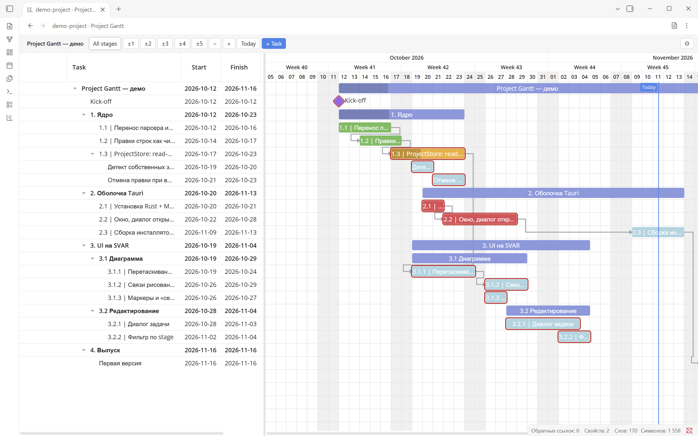
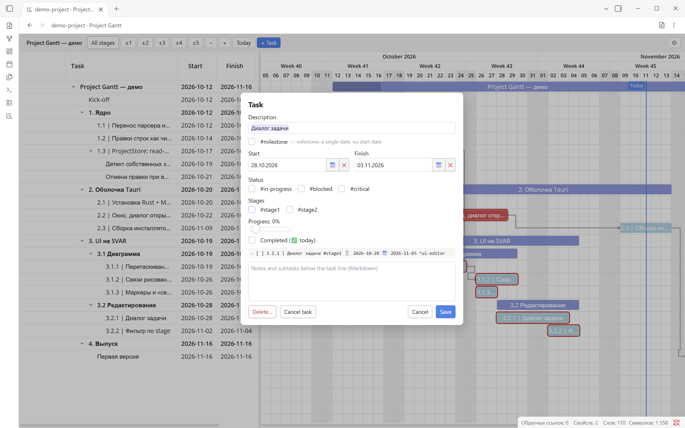

# Project Gantt for Obsidian

Edit Markdown project plans as interactive Gantt charts inside Obsidian. Chart changes are saved directly to your notes.

Created by **bvn13**, using Svelte 5, SVAR Gantt, and the shared [Project Gantt core](https://gitea.bvn13.me/management/project-planner-core).

## Screenshots

The bundled development-plan demo running in Obsidian. The interface is set to English; task names remain in the original Russian Markdown.



Edit dates, status, stages, progress, and Markdown notes in the task dialog:



## Features

- Edit task dates, progress, dependencies, and task details.
- Reorder and nest tasks and groups, and filter by project stages.
- Open a chart in the current tab or beside a Markdown note.
- Launch from the command palette, left ribbon, or file context menu.
- Resolve linked notes and embeds through Obsidian's metadata cache.
- Keep multiple views open with independent layout and interface state.
- Follow Obsidian's theme and detect stale edits before saving.

Obsidian handles file navigation. The plugin has no separate file picker or recent-files list. HTML export is currently available in the separate desktop application, not in this plugin.

## Dependencies

| Dependency | Requirement | Purpose |
| --- | --- | --- |
| Obsidian desktop | Required host application | Provides the workspace, vault access, Markdown views, and plugin settings. Minimum API version: 1.8.7; tested with Obsidian 1.15.0. |
| [Obsidian Tasks](https://github.com/obsidian-tasks-group/obsidian-tasks) | **Optional companion plugin** | Project Gantt's task syntax is based on the Tasks emoji metadata format, including scheduled, start, due, and completion dates. Installing Tasks is optional: Project Gantt parses and edits Markdown itself and does not call the Tasks plugin API. |
| `@project-planner/core` | Required; bundled into the plugin | Shared Markdown parser, editing operations, document store, localization, and Gantt editor. Built from the sibling core repository. |
| Svelte 5 | Required; bundled | Component framework for the editor, dialogs, and reactive interface. |
| SVAR Gantt and SVAR Core | Required; bundled through the core | Chart rendering, dependency visualization, calendar widgets, and widget localization. |
| CodeMirror 6 and Lezer | Required; bundled through the core | Markdown editing and syntax highlighting in task and group notes. |
| `yaml` | Required; bundled through the core | Reads and updates project settings in YAML frontmatter. |
| Node.js, npm, TypeScript, and Vite | Development/build only | Install dependencies, check types, and compile the plugin. Not required for users installing a built release. |
| Vitest and svelte-check | Development only | Run unit tests and validate Svelte/TypeScript code. |

Bundled libraries do not need to be installed separately in Obsidian. Exact versions are recorded in this repository's and the core repository's `package.json` and lockfiles.

**Task format compatibility:** Project Gantt supports a subset of Tasks-style metadata and adds its own conventions, such as `🚴` progress, `#milestone`, stage tags, and dependencies based on Obsidian block IDs. This does not imply support for every Tasks feature or identical dependency syntax. See the [Tasks date-format documentation](https://github.com/obsidian-tasks-group/obsidian-tasks/blob/main/docs/Getting%20Started/Dates.md) for the original date markers.

## Supported environment

This is a **desktop-only** plugin. Version 2.0.3 has been tested on Windows with Obsidian 1.15.0. The minimum supported API version is 1.8.7, required for Obsidian's language API; that older application version has not been verified.

## Language

Open **Settings → Community plugins → Project Gantt** and choose **System**, **English**, or **Русский**. System follows Obsidian's language; unsupported languages fall back to English.

The preference is saved using Obsidian's plugin data storage (`data.json` inside the plugin directory), separately from project notes. It applies to commands, plugin notices, the chart, dialogs, and calendars. Changes apply immediately to open charts and close any open task/settings dialogs, so save edits before switching. The ribbon button keeps the language-independent name **Project Gantt**.

## Manual installation

1. Build the plugin as described below, or use a packaged build supplied by the author.
2. Create `.obsidian/plugins/project-gantt/` inside your vault.
3. Copy `main.js`, `manifest.json`, and `styles.css` from `dist/` into that folder.
4. Reload Obsidian and enable **Project Gantt** under Community plugins.

On Windows, `npm run package` creates `dist/project-gantt-2.0.3.zip`. Extract its three files into the plugin folder. Disable any earlier build using the ID `project-planner` first; the Markdown format is unchanged.

## Open a project

Open a Markdown project note, then select a command:

| Action | Current interface label | Command ID |
| --- | --- | --- |
| Open in the current tab | Open current file as Gantt | `project-gantt:open-planner` |
| Open beside the note | Open Gantt beside current note | `project-gantt:open-planner-beside` |

Assign hotkeys in Obsidian's settings. Both commands are always available; if no Markdown file is active, the plugin displays a notice.

The chart icon in the left ribbon opens the current file. Its tooltip is **Project Gantt**. Toggle its visibility from the ribbon's context menu. Right-click a Markdown file and choose **Open in Project Gantt** to open a chart beside it. The file-text action in the chart header returns to Markdown. The table above shows English command labels; Russian labels are available through the language setting.

## Markdown editor commands

These commands work **only in Obsidian's Markdown editor**, on the current line. Assign keyboard shortcuts in **Settings → Hotkeys**, searching for **Project Gantt**. No default shortcuts are assigned, and no Gantt toolbar buttons are added.

| Command (English) | Command ID, after the `project-gantt:` prefix |
| --- | --- |
| New task (with dates) | `tasks-enhancer-new-task` |
| New plan task (with dates) | `tasks-enhancer-new-plan-task` |
| Start working on task | `tasks-enhancer-start-work` |
| Add creation date | `tasks-enhancer-add-created-date` |
| Add or postpone scheduled date | `tasks-enhancer-add-scheduled-date` |
| Add or postpone due date | `tasks-enhancer-add-due-date` |
| Cycle task priority | `tasks-enhancer-cycle-priority` |
| Move task block up | `tasks-enhancer-move-block-up` |
| Move task block down | `tasks-enhancer-move-block-down` |

Creation converts the current text line or bullet into an unchecked task, preserving indentation. Existing unchecked tasks keep their dates. **Start working** adds a missing `🛫` date; **Add creation date** adds a missing `➕` date. Scheduled/due commands add today's date if absent, or advance the existing date by one day. Priority cycles through `🔺`, `⏫`, `🔼`, `🔽`, and `⏬`.

In the plugin settings, configure the dates added to ordinary and planned tasks separately: `➕` creation, `⏳` scheduled, and `📅` due. All six options default to enabled and use today's date. Postponement can skip configurable weekend days; this is disabled by default, with Sunday/Saturday configured as weekends. These preferences are stored in plugin data alongside the language, not in project Markdown.

Movement transfers the complete list block, including nested tasks and indented notes, without crossing headings. Plain bullets and numbered list items are supported, and ordered numbering stays with list positions. Commands edit the current editor buffer, including unsaved changes, without writing through the Vault API. Each change is one undo step; cursor position and a single-line selection follow the edit. Multi-cursor and multi-line selections are left unchanged. Date/priority commands leave completed, cancelled, and other non-open checkbox states unchanged.

Command names follow the selected English/Russian language. Their short IDs match the old plugin, but the plugin prefix changed: reassign shortcuts previously bound to `obsidian-gantt-planner-plugin:`. No old hotkey settings are modified automatically.

Implementation: [editor commands](src/editor-commands.ts), [task settings](src/task-settings.ts), and [settings tab](src/settings.ts).

## Markdown example

A project starts with a level-one heading. Subheadings define groups and checklist items define tasks:

```markdown
# My project

## Development

- [ ] First task ⏳ 2026-11-11 📅 2026-11-13 ^first
- [ ] Release #milestone 📅 2026-11-16 ⛔ ^first ^release
```

Opening a project adds missing task block IDs (`^id`) to its Markdown. Chart edits modify the note directly. More examples are available in the core repository's `samples/` directory.

## Saving and multiple views

The storage adapter uses vault-relative paths, the Vault API, and `Vault.process` for atomic updates. Links resolve through the metadata cache.

If an open Markdown editor contains unsaved changes, or a task dialog is based on an older document version, the chart edit is rejected with a notice. Let the editor save, then retry the action or reopen the dialog.

Each view has its own store and interface state. Column widths are saved in the workspace layout. Disabling the plugin returns its documents to Markdown views; the original pane arrangement may change.

Implementation: [storage adapter](src/storage.ts), [view lifecycle](src/view.ts), and [plugin entry point](src/main.ts).

## Build from source

Place this repository next to `project-planner-core`:

```text
workspace/
  project-planner-core/
  obsidian-project-planner-plugin/
```

Use Node.js and npm. The installed Vitest version supports Node.js `^22.12.0 || ^24.0.0 || >=26.0.0`; Node.js 24 satisfies this range.

From the plugin directory:

```sh
npm --prefix ../project-planner-core ci
npm --prefix ../project-planner-core run build
npm ci
npm run check
npm test
npm run build
```

The build produces `dist/main.js`, `dist/styles.css`, and `dist/manifest.json`. Fonts are bundled into CSS. `npm run dev` watches sources and rebuilds the plugin.

The dependency is currently `file:../project-planner-core`, so both repositories are required. Its package name remains `@project-planner/core` despite the Project Gantt product name.

Build definitions: [package.json](package.json) and [vite.config.ts](vite.config.ts).

## Verification

To regenerate these screenshots on Windows using an isolated Obsidian profile, run `node scripts/smoke-obsidian.mjs --screenshots` after building the plugin. This runs the integration checks, captures the demo chart and task dialog, and updates the image files in this repository and the sibling core repository.

```sh
npm test
npm run smoke
npm run smoke:obsidian
```

- `test`: storage adapter unit tests.
- `smoke`: builds and tests the CommonJS bundle in headless Edge with a minimal Obsidian API host. Set `EDGE` to override the browser path; the debugging port is 9334.
- `smoke:obsidian`: builds and runs installed desktop Obsidian in a separate profile with a temporary vault. This runner currently supports Windows and does not copy or modify your working profile or notes. Set `OBSIDIAN_BINARY` or `OBSIDIAN_ASAR` to override application discovery.

The real Obsidian run passed 35 checks on version 1.15.0: commands, ribbon actions, saving, conflicts, multiple views, layout restoration, renaming, embeds, themes, deletion, language switching, editor-only task commands, unsaved-buffer edits, cursor/selection preservation, undo/redo, and task-setting persistence. Results remain in `.test-runtime/obsidian-*/results.json`.

Pop-out windows, mobile devices, and extended use alongside arbitrary third-party plugins have not been verified. See [PLAN.md](PLAN.md) for the implementation plan and progress; that document is in Russian.

## License

Copyright (c) 2026 bvn13. Distributed under the [Project Gantt No-Sale License 1.0](LICENSE).

Personal and commercial use, modification, and free redistribution are permitted. Selling copies or paid forks, paid software bundles containing the covered code, and paid hosted access require separate written permission from bvn13. Paid support, training, installation, and development services are permitted subject to the license conditions. Third-party components retain their own licenses.

This is a source-available project with restrictions on paid distribution, not an OSI-approved open-source license. The full license text governs.

<!-- docs-source: repository=https://gitea.bvn13.me/management/obsidian-project-planner-plugin.git; branch=feature/markdown-task-commands; commit=fa144a5e4e9235d9fc6eb17bb6849f4451c2941b; tag=; path=README.md; dirty=true -->
